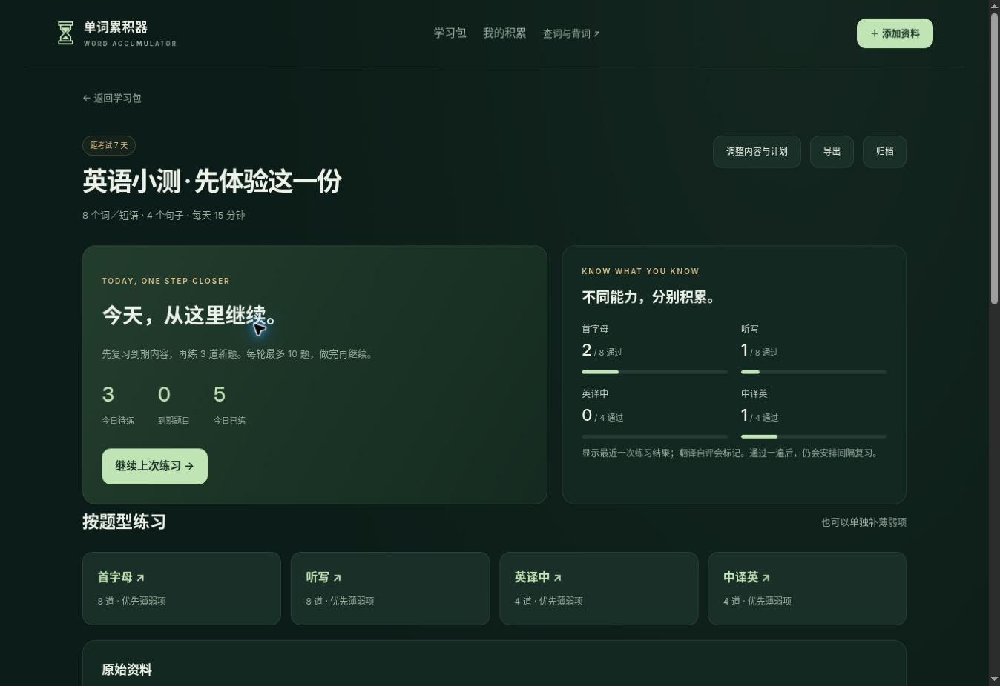

# 第二阶段：备考学习包

入口：现有首页「备考学习包」或 `exam.html`。本阶段不改动原有背词、收藏、词库及其 localStorage。

## 已实现的范围

- 多图和 TXT/CSV/TSV 导入；粘贴词表、双语句子；本地 OCR，识别失败逐文件提示并可重试。
- 编辑、勾选预览，词典补齐缺失释义（提示用户按原文核对）。相同词义去重但合并来源，不合并不同词义。
- 来源保留原文、行号和压缩图片；学习和练习均可查看。
- 首字母（优先原文例句）、听写、英译中、中译英，单独记录技能进度。
- 翻译采用标准答案及用户认可的其他答案。不同表达先人工自评；没有用字符串相似度冒充语义批改，也没有伪装已接入 AI。
- 考试日期、每日分钟数、到期优先的学习安排、错题重练、暂停续练、归档、跨学习包词句积累。
- IndexedDB 原子保存、并发修改检测，学习包完整备份及副本导入（含图片与进度）。

## 数据与限制

学习包留在当前浏览器，尚无账号云同步。第一次创建时下载站内词典分片；图片识别组件在浏览器执行，原图不会上传。Tesseract 的引擎和语言资源首次从其官方指定 CDN 下载并由其缓存。最长识别时间和取消操作用于避免无限等待。

单个学习包最多 300 条、10 个上传文件，单文件上限 12 MB。图片缩至最长边 1900 像素，用于识别与来源留存。备份导入上限 30 MB。长期存储不等于云备份，用户可导出自己的数据。

语音沿用站内 speak.js/eSpeak，英美音可切换；相关 GPL 来源与许可沿用 pronunciation/synth/LICENSE.txt。OCR 浏览器程序来自 Tesseract.js 5.1.1（Apache-2.0），见 vendor/tesseract/LICENSE.txt。示例词表和例句为本项目原创。词典仍按原有许可与署名分发。

## 后续商业阶段

独立商业托管、通用账号与云同步、服务端 AI 语义批改、付费权益与额度管理需另外接入。现有 GitHub Pages 版本不包含付费购买、虚拟付费解锁或外露 API 密钥。不要把本阶段页面描述为商业版已准备就绪。

## 验证

运行 `node --test tests/*.cjs`，包括来源与多词义、翻译否定句、复习时间、分项技能记录、备份校验。15 项自动检查通过。通过实际浏览器操作验证多图与文字混合导入、勾选和修订、来源原图、四类练习、重载续练、错题重练、翻译自评及答案保存、归档，以及备份导出后副本恢复。用两张原创中英混排截图完成 OCR 实测，并检查 390 像素宽度的首页与练习布局。

